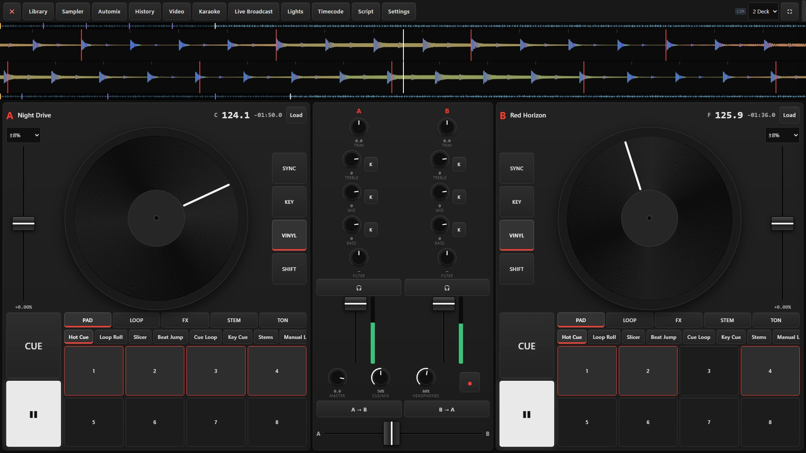

<h1 align="center">Mr. Mars Music Studio All in 1 · Touch</h1>

<b>A full music studio and a real DJ controller, right on your touch screen.</b> No install. No account. No cost. Open the link and play.

<a href="https://merihdogan.github.io/Mr.Mars.Music.Studio-All-in-1-Touch/"><b>▶ Open the live app</b></a> · <a href="User%20Manual_en_english.pdf">Manual (PDF)</a> · <a href="LICENSE">MIT License</a> · Version M.D.26/ V.08.11. Touch

## What it is

Mr. Mars Music Studio All in 1 is a complete music workstation and DJ system that runs in your browser. Write and record a track, play your guitar through an amp rack, mix a set on up to four decks, put visuals on a second screen, go live, and send the finished file to your phone with one QR scan.

Everything runs on your own computer. Your music is not uploaded anywhere to be processed, and after the first visit the app works offline.

This edition is built for touch. On a large touch screen the DJ Mixer becomes a full-size controller you play with your hands.

## Play it like real hardware

Press **⛶ Touch Controller** in the DJ Mixer tab and the whole screen turns into a controller.

| | |
|---|---|
| 💿 **Scratch with your hand** | Large jog wheels follow the angle of your finger. Touch the record and the sound follows you forwards and backwards. The outer ring bends the tempo, just like the edge of a platter. |
| 🖐 **Every finger counts** | Pads, faders, knobs and the crossfader each follow their own finger. Hold a loop, ride the crossfader and scratch at the same time. |
| 🎚 **A complete desk** | Two or four decks, three or four band EQ with kills, filter, trim, tall channel faders, tempo faders, headphone cue and a big crossfader. |
| 🥁 **Performance pads** | Hot Cue, Loop Roll, Slicer, Beat Jump, Cue Loop, Key Cue, Stems, Scratch patterns and more, eight large pads per deck. |
| 📂 **Nothing is hidden** | Library, Sampler, Automix, History, Video, Karaoke, Live Broadcast, Lights, Timecode, Script and Settings all open in a side sheet sized for fingers. |
| 📐 **Every tab, not just DJ** | Arranger, Mixer, Pattern Rack, Amp Rack and the rest get larger controls on touch screens. Chords work on the on-screen piano. You can set this to automatic, on or off. |

## New in this version

**Upd.13.11**
- **Sections:** mark Intro, Chorus and other parts above the ruler; move, duplicate or delete a section with every track's clips and automation.
- **Overview strip:** the whole song in miniature; drag to scroll, drag the edges to zoom, double-click to fit.
- **Phrase lines** every 4, 8, 16 or 32 bars.
- **Version history:** every save is a version described by what changed; open, branch, star and note versions.
- **Command palette** (Ctrl+Shift+P): every command in one search field.
- **Stereo map** in the Mixer: set pan and volume by dragging a dot, and see where each sound really sits and how wide it is.
- **Discard and retry take** (Ctrl+.).

| Feature | What you get |
|---|---|
| 🎻 **Real instruments** | Piano, strings, winds, brass, guitars, basses and mallets now play real CC0 recordings. Real percussion includes darbuka and frame drums. |
| 🎙 **Your own sounds** | Assign audio files, an SFZ folder or a SoundFont to any instrument, so a ney or kanun can play your own recordings. |
| 🎛 **More pro tools** | Real amp captures (.nam), true sidechain, master automation, MPE and shared projects for up to 4 people. |
| ⚡ **Faster stems** | Vocal, drum, bass and melody separation now uses all your processor cores. A three-minute track splits in seconds while the app stays responsive. |
| 🎛 **Timecode vinyl and CD** | Drive a deck from a real turntable or CD player with timecode media. Speed and direction are read from the stereo signal (relative mode). |
| 🎤 **Karaoke** | Synced LRC lyrics, tap-to-time for any text, vocal level control, a singer queue and lyrics on the video output. |
| 📡 **Live broadcast** | Share a link or QR code and up to 8 listeners hear your mix directly from your device, with video if you want. For a bigger audience, stream MP3 to an internet radio server through the small included bridge program. |
| 💡 **DMX lights** | Connect a USB DMX interface, list your fixtures and let beat-driven scenes run the room. |
| 🎞 **42 video transitions** | GPU transitions between decks, from clean wipes to warp tunnels. |
| ⌨️ **Your own commands** | A small script language for custom buttons: `B.sync ; B.play ; fade xfader 1 16b`. |
| 🎶 **Smarter sets** | Build a harmonic set from your library by key and BPM flow, then export the Tracklist, a CUE sheet or CSV. |
| 🖤 **Premium look** | Charcoal panels, black knobs with a thin white arc and a single red LED for what is on. |

## Everything in one place

| | |
|---|---|
| 🎚 **Produce** | Arranger, Session, Pattern Rack, mixer and automation |
| 🎧 **Perform** | 4-deck DJ Mixer with stems, Automix and transition recipes; ready mappings for 106 controller models and an assign wizard for the rest |
| 🎸 **Sound** | 125 instrument sounds, Amp Rack and 50+ effects, including European metal tones and basses |
| 🇹🇷 **East meets West** | 15 Turkish maqams in 53-comma tuning for each track, 20 Turkish instruments, 7 fretless electric guitar tones and 22 Eastern percussion sounds |
| 🎼 **Start fast** | 23 backing styles from House to Oriental; Re-Play turns audio into notes, tabs and MIDI |
| 📱 **Send to phone** | One QR scan and the music goes directly to your phone, with no file upload |
| 💿 **Release ready** | MP3, AAC, WAV, AIFF, FLAC, Apple Lossless and Opus, with LUFS targets, a true peak limiter and a batch Format Converter on your own computer |
| 🌍 **Portable** | 7 languages, offline after the first visit, or run it from a USB folder |

 

## Getting started

1. Open the [live app](https://merihdogan.github.io/Mr.Mars.Music.Studio-All-in-1-Touch/) in Chrome or Edge. These browsers support MIDI, USB devices and the full audio feature set.
2. Go to **DJ Mixer**, press **⛶ Touch Controller** and load a track from the side sheet.
3. Touch the record to scratch. Press ✕ at the top left to go back to the normal view.

To run it without internet, download this repository and open `index.html`. For internet radio, run `node yayin-kopru.js` on the same computer. Node.js is needed only for that bridge.

## Good to know

- Stem separation uses signal processing, not a neural network, so results are approximate.
- Timecode runs in relative mode: moving the needle to another spot does not jump in the track.
- Touch behaviour depends on your screen and how many touch points it reports.
- Hardware controllers and lighting interfaces vary. Ready mappings have not been tried on every device.
- Browsers cannot connect to paid streaming catalogues without licences, so you play your own files.

## Every tab is a studio of its own

| Tab | What makes it stand out |
|---|---|
| 🎼 **Arrange** | Audio and MIDI tracks, takes and comping, piano roll and automation lanes. Right-click a clip to split it into vocals, drums, bass and melody, fit it to the tempo or shift its pitch. |
| 🎬 **Session** | Launch clips and whole scenes live, always on time. Build ideas on a grid, like a performance instrument. |
| 🥁 **Pattern Rack** | Step sequencer up to 64 steps with accents, ghost notes and swing. One click writes a full backing in 23 styles, as MIDI you can edit. |
| 🎛 **Mixer** | Insert effects, send channels, pan, faders, meters and master chain. Any tab or panel can open in its own window for a second screen. |
| 🕹 **Mini Tools** | XY synth pad and XY effect pad with filter, bitcrusher, gater and beat repeat. Arpeggiator, chord and scale tools, a 2-channel looper and 4×4 pads. |
| 🎵 **Re-Play** | Drop in a song or a video. Get notes, score, guitar and bass tabs, riffs and MIDI, then replay it on any of 125 instruments. |
| 🎸 **Amp Rack** | Plug in your guitar. Amps, cabs, pedals, tuner, 2 and 3-way splitters, parallel stereo and a live mode with MIDI preset switching. |
| 🎧 **DJ Mixer** | 2 or 4 decks, real vinyl-style scratch, slip, quantize, stems, Automix, 7 transition recipes, sampler banks and a 30-minute set memory. |
| 📺 **DJ Video Engine** | Video decks play in sync, with visualizers, camera, slideshow and a full-screen output for a second screen. |
| 🌍 **East·West·Afro** | 38 maqams and scales: Turkish, Arabic, African, Western and your own .scl files. Polyrhythmic sequencer for 9/8 aksak and Afro grooves, live drone, Tension macro and one-button DROP. |
| 🤘 **Metal Creative** | Riff Factory with 8 styles and 9 tunings, Song Workshop that builds a multitrack song, 97 ready amp tones, 7/8-string guitars and 90 industrial sounds. |
| 🧩 **Plugins** | Write your own effects and instruments in JavaScript and use them on every track. |

 

## Türkçe tanıtım

**Tarayıcında tam bir müzik stüdyosu. Kurulum yok, hesap yok, ücret yok.** Şarkını yaz, gitarını tak, setini çal, QR'ı okut ve müziğini telefonuna al.

- **Aranjman:** ses ve MIDI parçaları, otomasyon, klibi vokal, davul, bas ve melodiye ayırma
- **Session ve Desen Rafı:** canlı klip başlatma, adım sıralayıcı, tek tıkla 23 türde altyapı
- **Yeniden Çal:** şarkıyı notaya, taba ve MIDI'ye çevir, 125 çalgıdan biriyle yeniden çal
- **Amfi Rack:** amfi, kabin, pedal, akort aleti ve canlı sahne kipi
- **DJ Mikser:** 4 deck, scratch, stem, Automix, geçiş tarifleri, sampler ve video motoru
- **Doğu·Batı·Afro:** 53 komalı makamlar, 9/8 aksak ve Afro kalıpları, dem sesi ve tek tuşla DROP
- **Metal Creative:** riff fabrikası, şarkı atölyesi, 97 hazır amfi tonu
- **Mini Araçlar ve Eklentiler:** XY pedler, looper, arpej ve kendi eklentini yazma

---

MR. MARS MUSIC STUDIO ALL IN 1 — M.D.26/ V.08.11. Touch · Upd.13.11 ·

From Traditional to Universal: Limitless Performance  
Mr.Mars Studio originally began as a dedicated tool to streamline live performances for musicians blending electric guitar and saz with DJ gear.  
Today, it has evolved into a universally compatible ecosystem—empowering artists to produce music and perform live on stage using either full hardware setups or purely standalone software.  
While versatile enough to create any genre through DJ tools and MIDI controllers, at its core, it is a unique Euro-Turk innovation that fuses Northern European and Eastern cultures, synthesizing traditional instruments with modern musical disciplines.  
Its plugin expandability and seamless integration with industry-standard DJ equipment elevate Mr.Mars Studio into a truly global league.

**User Manual:** [PDF](User%20Manual_en_english.pdf) · [Web page](https://merihdogan.github.io/Mr.Mars.Music.Studio-All-in-1-Touch/User%20Manual_en_english.html). In the app, press ❓ Manual beside the top menus.

================================================================

STARTING
--------
- Double-click "Mr Mars Music Studio.cmd". No installation and no internet needed.
  The app opens Microsoft Edge or Google Chrome in its own window with its own
  separate profile.
- "Masaustu Kisayolu Olustur.cmd" adds a "Mr. Mars Music Studio" shortcut with the
  logo to the desktop and Start menu. Run it once after moving the folder to a new PC.

USB / ANOTHER COMPUTER
----------------------
Copy the whole "Mr Mars Music Studio All in 1" folder to a USB drive. Projects,
recordings, settings and installed plugins live in the "veri" folder inside it.
Backup / sharing: File > "Export project file (.mrmars)" creates a single complete
project file including audio. Older .orbit project files can also be opened.

FOLDER LAYOUT
-------------
mrmars-cekirdek   : audio engine, project, automation, DSP, tuning, MIDI, translations
mrh-cihazlar      : instruments, effects, amps / cabs / pedals, metal devices
dgn-arayuz        : tabs, windows, DJ, Metal Creative, plugin manager
dgn-tema          : interface theme
mrmars-gorseller  : logo and icons
mrmars-eklentiler : plugins you add
veri              : your projects and settings

LANGUAGE
--------
The default language is English. The app opens in your browser's language when it is one of
English, Deutsch, Español, Français, Svenska, Türkçe or Русский; any other browser language
opens in English. To choose by hand, use the 🌐 button beside the top menus. "Automatic" there returns to the browser language.

TABS
----
Every tab can open in its own window: the ⧉ on the tab name, a double-click, or
right-click > "Open in separate window". Panels have their own ⧉ (top right).
Closing a window returns the content to its place; positions are remembered.

Arrange      : Audio and MIDI tracks, recording (takes / comping), clip editing (move,
               trim, split, duplicate, reverse, normalize, fades), loop, metronome, piano
               roll, audio / MIDI import, automation lanes, mixdown and stem WAV export.
               Right-click an audio clip: split into stems (vocals / drums / bass /
               melody), fit to tempo (pitch kept), pitch shift.
Session      : Track × scene clip grid; quantized clip launch, one-click scenes.
Pattern Rack : Step sequencer: 16/32/64 steps, accent / ghost notes, swing, random,
               write patterns to the arrangement as MIDI clips.
               Backings button: 23 ready genres (drums, bass, chords) as editable
               MIDI tracks; choose key and length (4, 8 or 16 bars).
New guitars   : Electric Guitars (25 tones: single-coil, humbucker, hollow body, crunch,
               high gain, metal with palm mute, fuzz, surf, European metal styles...),
               Electric Basses (9 tones) and Fretless Electric Guitar
               (Turkish) (7 tones) in Re-Play and the instrument menu. Fretless tones slide
               between notes and have wide vibrato; choose a maqam and tonic per track.
               Turkish Instruments (20) and Bowed Strings (16, with electric violin, hurdy-gurdy,
               nyckelharpa and other European fiddles) are in the instrument menu too.
               Viking Instruments (11): tagelharpa, lyres, horns, flutes, jaw harp, frame drum.
               Each instrument appears in one list. Old projects keep playing any sound moved or removed from a list.
               The Drum Machine also has Turkish and Middle Eastern percussion (notes 65-86):
               darbuka, bendir, def, erbane, riq, kudüm, davul, nakkare, finger cymbals, spoons,
               çarpara, tombak, daf and mazhar, with an Eastern Percussion level knob.
Format Converter: Tools menu. Converts many audio or video files on this computer to WAV, AIFF,
               FLAC, Apple Lossless, MP3, AAC, Opus or MP4 with bit depth, bitrate, sample rate and
               channels. Trim, fades, track details and cover; download singly or as ZIP. Nothing is uploaded.
Quality settings: in Send to Phone, Mixdown and Format Converter. Loudness target in LUFS, true peak
               limiter, high-pass, bass, treble, stereo width, compressor, dither.
Send to Phone: top bar button, in every tab. Sends the project, the loop region or the latest
               DJ mix to a phone. Formats: MP3 192/320, AAC M4A, MP4, and for distribution WAV 24-bit
               44.1/48/96 kHz, WAV 16-bit, FLAC 16/24-bit and Apple Lossless. Save to computer too.
               Scan the QR code with the phone and the music
               arrives right away, with no upload. The phone can ask for other formats too. Both
               devices need internet to connect; only encrypted connection details use a relay.
New devices: Creative effects (Envelope Filter, Vinyl, Exciter, De-esser, Harmonizer,
Trance Gate, Vocoder) in the effect menu; Recorded Drum Kit in the instrument menu.
Mixer        : Insert slots, sends (FX channels), pan, fader, meters, master.
Mini Tools   : XY synth pad, XY effect pad (filter, delay, reverb, flanger, phaser,
               bitcrusher, pitch, gater, beat repeat), MIDI tools (transpose, scale,
               chord, arpeggiator, velocity curve), 2-channel looper, 4x4 pads (note repeat).
Re-Play      : Turns a music file (MP3, WAV, OGG, FLAC, M4A, MP4 / WebM or MIDI) into notes
               and plays it back with the instrument you choose (125 instruments: guitars,
               bağlama, cura, oud, kanun, ney, clarinet, zurna, kemençe, strings, piano,
               synth...). Outputs: score (print / PDF / SVG), XML, MIDI, guitar and bass
               tab, Do-Re-Mi list, repeating riffs.
Amp Rack     : Live guitar / bass: tuner, pedalboard, amp head, cab (2 mics, your own IR),
               single / 2-way / 3-way split or stereo routing, DI path, modulators (LFO /
               envelope / step), live preset mode, MIDI Program Change, tap tempo, print
               the rig to an audio track.
DJ Mixer     : 2 or 4 decks; BPM and key detection, beat grid, SYNC, KEY LOCK, tempo, jog,
               nudge, CUE, 8 hot cues, loops, pad modes (Hot Cue, Loop Roll, Slicer, Beat
               Jump, Key Cue, Stem...), stem buttons, deck effects, 3-band or 4-band
               isolator EQ + kills, resonant filter, crossfader curves, FX A / FX B send
               effects, headphone cue, sampler, microphone (talkover), Automix, library,
               playlists, set recording.
               Library import / export: DJ Library XML, DJ Collection NML, M3U / M3U8 (BPM, key,
               beat grid, hot cues, playlists).
East·West·Afro: Microtonal tuning (Turkish maqams in 53 koma, Arabic maqams, African
               scales, tuning file (.scl)), polyrhythmic usul / Afro-groove sequencer (14 presets),
               World Percussion instrument, live drone / atmosphere, Tension macro and DROP.
Metal Creative: See the section below.
Plugins      : Installed devices, loading external plugins, template, API document.

METAL CREATIVE
--------------
- MRH Riff Factory: 8 styles (Modern Metal, Metalcore, Deathcore, Slam, Nu Metal, Djent,
  Thrash, Breakdowns) × 9 tunings (Drop E 8-string … Standard E) × 8 section types (Main
  Riff, Verse, Chorus, Breakdown, Lead / Solo, Clean Section, Transition, Intro); 40 riff
  chunks per combination. Each chunk is 2 bars: guitar + bass + drums + synth + industrial
  FX generated together; the kick follows the guitar chugs. ▶ previews, "⇣ Project" writes
  at the playhead.
- DI pack (.zip): for 20 / 40 chunks, double-tracked DI guitar WAVs, bass DI WAVs, optional
  amped guitar WAVs and guitar / bass / drum / synth MIDI files.
- DGN Song Workshop: ready song structures, random song, section order / repeats / riff
  number; "Write to project" builds the "MC ·" tracks (Guitar L / R, Bass, Drums, Lead,
  Clean Guitar, Synth, Industrial FX) and sets tempo and loop. Also downloadable as MIDI (.zip).
- Instruments: Metal Guitar DI (7/8-string; palm mute, down / alternate / auto picking,
  tightness, dynamics, string release noise, double tracking), Metal Bass (5-string; DI /
  Amp 1 / Amp 2 / Clean), Metal Drum Kit (china, stack, splash, ride bell, two kicks),
  Industrial Destruction FX (90 sounds; Hit, Sub Bass, Stereo, Room, Color, Shatter).
  Rule: guitar / bass notes with velocity 100 or less = palm mute, higher = open string.
- DI Booster (before the amp): Body, Deep Octave, String Shine, Saw Distortion (Drive /
  Level / Bass / Mid / Treble / Mix), Metal Ring, Squash.
- Drum Fist: Hit, Grit, 3-band Transient (attack / sustain), Boom 100 Hz, Air 8 kHz, Mix.
- Mr. Mars Metal Tone Archive: high-gain amp × cab tones + Deathcore, Thrash, Djent,
  Nu Metal, Swedish Death Metal and bass packs; apply to the selected or a new guitar track.
- MRH metal synth presets (also listed as "MC ›" in the Digital Mini Synth).
- Metal mix template: drums, double guitars, bass, synth, FX, vocal chain, reverb / delay
  returns, master EQ + glue compressor + limiter (optionally with an example song).

MR. MARS AMP AND CAB SERIES
---------------------------
Amps are named by style. Clean: Clean, Bright Clean, Clean Reverb, Clean Jazz. Crunch: Crunch, Classic Crunch, Bright
Crunch, Vintage Combo, Warm Combo, Soft Overdrive. Lead: Lead, Smooth Lead, Hard Rock. Metal: High Gain, Modern
Hi-Gain, Heavy Metal, Tight Metal, Modern Metal. Bass: Bass Tube, Bass Modern, Bass Classic, Bass Hi-Fi, Bass Overdrive.
Cabs are named by size and style: 1x10 Small, 1x12 Open, 1x12 Open Combo, 1x12 Warm, 2x12 Classic, 2x12 Bright, 2x12
Open Vintage, 2x12 Stereo Clean, 4x12 Modern Closed, 4x12 Vintage Closed, 4x12 High Power, 4x12 Big Body, 4x12 Tight,
4x10 Warm Combo and bass cabs. Load your own cab IR (.wav) with "Use IR".

AUTOMATION
----------
The "A" button in a track header opens automation lanes: Volume, Pan or any device
parameter on the track. Click empty space to add a point, drag to move, double / right-
click to delete. R (Read) plays the curve, W (Write) records your moves while playing.
Automation also applies to mixdown and stem export.

PIANO ROLL TOOLS
----------------
Scale highlight / lock (major, minor, modes, pentatonic, blues, maqams), chord stamp,
arpeggiate, strum, split to grid, quantize, humanize, legato.

DJ TRANSITIONS AND SAFETY
-------------------------
- Transition recipes (Bass Swap, Fade, Echo Out, Filter Sweep, Reverb Out, Tape Stop, Cut) drive both
  Smart transition and Automix.
- "Start on beat": PLAY waits for the playing deck's next beat. "Match levels": evens out loudness.
- LIM lights when the safety limiter works. "Last 30 min" downloads the recent mix without recording.

CONNECTING DEVICES
------------------
Use Edge or Chrome on Windows and Mac. Plug the device in; there is no setup program. The
browser asks for permission the first time: choose Allow. The bottom-left "MIDI:" status shows
what the app sees.

MIDI keyboard
  Recognised automatically. Notes play the selected instrument right away.

DJ controller
  Common models are recognised when plugged in and load a ready mapping by themselves. A banner
  opens the Device menu, which lists your device's own controls; the one you touch lights up, and
  clicking a row lets you change it.
  Other models: a banner offers Map / Not now / Don't ask again. "Map" opens the wizard: move
  each control when asked and skip what your device lacks. The mapping is saved for that device.
  To change a control: DJ Mixer > Controller Center > "Assign a control". Touch the control on
  your device and choose a command. "Back to ready mapping" undoes your changes.
  Jog: touch the top and turn to scratch. Turn the edge to nudge the tempo during play.
  Ready mappings have not been tried on every device. If a jog feels too fast or slow, use
  "Jog sensitivity"; if the tempo fader runs backwards, use "Tempo fader direction".

Electric guitar / bass
  A guitar does not connect by MIDI. Plug it into the Hi-Z (instrument) input of an audio
  interface, connect the interface by USB, choose it as input and output under Tools > Audio
  settings, then open Amp Rack, press ⏻ and allow the microphone. Set the level on the
  interface's gain knob so that it does not clip.

Windows and Mac differences
  Driver       Windows: USB-MIDI usually works without one; a controller's built-in sound
               card may need the maker's driver. Mac: usually none needed.
  Other apps   Windows: a MIDI port usually serves one program, so close other DJ or music
               programs first. Mac: ports can be shared.
  Microphone   Windows: Settings > Privacy & security > Microphone.
               Mac: System Settings > Privacy & Security > Microphone.
  Browser      Edge or Chrome. Safari has no MIDI, and neither does any browser on iPhone/iPad.
  Latency      Browsers use the normal system audio path (no ASIO). Use a low setting under
               Tools > Audio settings; raise it if you hear crackling.

If it does not work
  "MIDI: no permission"  Allow MIDI in the site permissions (padlock in the address bar), reload.
  "MIDI: no device"      Try another USB port or cable, close other music programs, reload.
  "MIDI: not supported"  Switch to Edge or Chrome.
  No signal in the wizard  Some devices use HID rather than MIDI: try "Add HID device
                           (experimental)" in Controller Center.
  No guitar sound        Check the input in Audio settings, the microphone permission and gain.

MIDI AND CONTROLLERS
--------------------
- A common model loads its ready mapping when plugged in. For any other new device the app offers
  to map it; "Map" opens the wizard and saves the mapping to that device when finished.
- Right-click any knob > "MIDI learn" to bind a controller knob / fader to it. In the DJ
  Mixer, "MIDI Learn (controller)" maps every deck control; the mapping can be saved to a
  file and shared.
- 14-bit faders, pitch-bend tempo faders, jog touch (Vinyl mode) and controller button
  LEDs are supported.
- Tools > "MIDI settings": send MIDI Clock and follow external MIDI Clock / Start / Stop.

ADDING PLUGINS
--------------
1) Plugins tab > "Load plugin (.js)", or
2) put the .js file in the "mrmars-eklentiler" folder and add its name to
   mrmars-eklentiler\index.js.
Plugins register with MrMars.register({ ... }). See "Download plugin template" and
"API document"; "rotary-hoparlor.js" and "telefon-efekti.js" are examples.

EXPORT
------
File > Mixdown / Export: WAV (16 / 24-bit, 32-bit float), per-track stem WAVs, MIDI per
MIDI track, score (XML + printable SVG) and tab + riffs + note list (TXT).

AUDIO SETTINGS
--------------
Tools > Audio settings: input / output device, sample rate, latency mode (Lowest / Low /
Balanced / Safe; default Balanced), recording latency compensation, reset audio engine.
If the sound crackles, choose "Safe" and reduce the number of amp chains running at once.

SHORTCUTS
---------
Space: play / stop   R: record   L: loop   M: metronome   S: split   Del: delete
Ctrl+Z / Ctrl+Y: undo / redo   Ctrl+C / V / D: copy / paste / duplicate   Ctrl+S: save
Ctrl + mouse wheel: zoom   Drag in the ruler: loop region
With "Play with keyboard" on: A W S E D F T G Y H U J K = notes, Z / X = octave

KNOWN LIMITS
------------
- The app runs on the browser audio engine: external audio plugins and special audio
  drivers are not used directly; it is extended with its own plugin system.
- Stem separation and audio-to-notes use signal processing; results are approximate.
- Metal Creative riffs are rule-based generation, not recorded performances; edit them as MIDI.
- There is no true sidechain; the "Pump" effect does tempo-locked ducking.
- No automation on the master channel or the Amp Rack.

Mr. Mars Music Studio All in 1 — MRH DGN

License
-------
This project's own code is under the MIT License (see LICENSE). Third-party components keep
their own licenses, including the LGPL-3.0 MP3 encoder (see THIRD-PARTY-NOTICES.txt).
